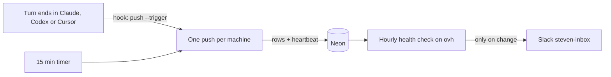

# Remote sync

Cleaned session text from both machines should land in one Postgres database so it can be searched from anywhere. This note is the map. The code is the spec.

## What is stored today

`sessions_fts.body` holds the full user and assistant turns, joined as `role: text`. Snippets are built at search time in `store.SearchOptsQuery`. Tool output is dropped in `transcript.blockText` before the body is built.

Measured on this Mac on 2026-09-28: 1,006 sessions, 14.0 MB of body text, average 14 KB, max 246 KB. Titles add about 145 KB. Raw transcripts are much larger (Claude about 435 MB, Codex about 535 MB, Cursor about 66 MB) because they include tool output.

`gitleaks dir --redact --max-target-megabytes 200` on the raw trees, same day: Claude 124 findings in 32 files, Codex 270 in 31 files, Cursor 20 in 4 files. The same command on `~/.cache/sessions` reported 0. That is the bar after a cleaned reindex. A SQLite file can hide a match that the raw JSONL shows, so the raw counts are the ones that matter.

`show` does not read that body. It loads the raw transcript through `source.Adapter.Load`. A copy of the index on another machine cannot render a conversation until the turns themselves are stored. Raw files stay owned by the agent tools.

## Pipeline

1. **Collect.** `indexer.Refresh` walks Claude, Codex, Cursor, T3, and conversations stored by `sessions import`.
2. **Clean.** `internal/clean`, called from `Refresh` before `store.Upsert`.
   - Exact values come from Doppler at run time and stay in memory. Each hit becomes `[REDACTED:NAME]`.
   - Pattern hits use the gitleaks rules linked in as a Go library (`github.com/zricethezav/gitleaks/v8`). Those become `[REDACTED:RULE]`.
   - Values shorter than 8 bytes are skipped. So are `true`, `false`, `yes`, `no`, `null`, `none`, `on`, `off`, letter-only values under 16 bytes, and other values under 16 bytes whose Shannon entropy is below 3.5 (regions, short hostnames). `DOPPLER_*` names are skipped.
   - Every project and config the logged-in Doppler CLI can read is included. A full read on this Mac took about 7 seconds. If the same name has different values, the placeholder is `PROJECT/NAME`, then `PROJECT/CONFIG/NAME`.
   - If cleaning a session fails, that session is not written. An older row for it is deleted. The raw file is not modified.
   - `meta.clean_fingerprint` is a hash of the secret set plus the gitleaks rule file. A change reindexes every session. The hash is not reversible. A Doppler read that yields no usable values is an error. `SESSIONS_SECRETS_JSON` writes the prefix `v1-override:` so that index is not mistaken for a Doppler clean later.
   - Paths, cwd, branch, and model are not redacted. `show` needs the real path. Exact matching does not catch percent-encoded or re-wrapped copies of a value. Gitleaks still runs on the text it can see.
   - The index schema is version 4. An older binary refuses it, so it cannot write raw turns over cleaned ones.
3. **Verify.** `internal/clean/clean_test.go` builds fake keys at run time and checks that none of them survive. Before any upload, `gitleaks dir ~/.cache/sessions --redact --max-target-megabytes 200` must report 0 findings. A one-time canary and a weekly trufflehog scan of exported rows come later and do not block the first upload.
4. **Upload.** `sessions push` refreshes, then upserts by source and id. Each row about to be uploaded must still redact to itself; unchanged rows were checked when they were uploaded under the same clean fingerprint and are not checked again. The row records `os.Hostname()`. A clean failure skips that session and does not delete the cloud copy. Missing previously indexed roots and discovery errors prevent deletion. A complete empty snapshot releases that machine's remote ownership. Shared source/id rows have separate machine ownership records and disappear only after the last machine releases them. A row with no owner is never deleted by a push. `SESSIONS_SECRETS_JSON` (`v1-override:`) is refused. Every row carries `owner` (`SESSIONS_OWNER`, required) and `brain` (from the brains.json map, NULL when nothing matches); an unchanged row whose tags differ gets a one-line `UPDATE` instead of a re-upload. Upserts, ownership writes and the schema are pipelined, and rows the machine already owns are not rewritten, so a push with nothing new takes about 16 seconds on the Mac (most of it the Doppler read), not one round trip per session.
5. **Store.** Neon project `sessions` (`falling-field-30105744`), database `neondb`, table `sessions`. Schema is `internal/remote/schema.sql`: metadata, cleaned body, turns as jsonb, a generated `search` tsvector, and a GIN index. No raw JSONL. `DATABASE_URL` (owner) and `DATABASE_URL_READONLY` live in Doppler project `sessions`, configs `dev` and `prd`. `doppler.yaml` names that project. Nothing in the repo is a connection string.
6. **Access.** `sessions search --remote` and `sessions show --remote` use the read-only URL and do not refresh. SQL-created role `sessions_mcp_reader` has `SELECT` only. When a role named `brain_mcp` exists, the schema grants it `SELECT` on `sessions` too; brain-mcp filters by `owner`. `push` uses the owner URL and applies the schema.

`SESSIONS_SECRETS_JSON` points at a JSON object and replaces the Doppler fetch. `index` and `search` print a warning when it is set. Tests set it. Leave it unset for a real index.

If Doppler cannot be read, `index` and `search` stop before writing. The previous index is left as it is. Local `show` does not contact Doppler. `search --remote` and `show --remote` need `DATABASE_URL_READONLY` and do not read Doppler secrets for redaction.

A Doppler value that its own placeholder would contain (a bucket named like its project, `[REDACTED:project/NAME]`) is labelled `[REDACTED:NAME]`, or `[REDACTED:secret]` if that still contains it. Otherwise the placeholder fails the leftover check and the session is skipped on every run.

## Keeping it running

Three layers, so a stopped machine is noticed within a day instead of after weeks. On 2026-11-02 the shared copy was 19 days old: the Mac's launchd job had quietly unloaded and nothing reported it.



1. **Push when a turn ends.** `~/.agents/hooks/sessions-push.sh` runs on Claude `Stop` and `SessionEnd`, Codex `Stop`, and Cursor `stop`. It calls `sessions push --trigger`, prints `{}`, and always exits 0. The trigger writes `push.pending` in `~/.cache/sessions`, and returns if `push.lock` is held. Otherwise it starts `sessions push` detached (own session, output in `push.log`). `sessions push` writes the pending marker, takes an exclusive `flock` on `push.lock` (the kernel drops it if the process dies), and pushes while markers keep arriving, at most five times. A request written before the lock is tried is always seen: either the lock is free, or the holder finds the marker when it checks again after unlocking. `internal/pushlock` has the tests.
2. **Timer as a safety net.** `deploy/install-timer.sh` installs the 15 minute launchd job (`com.stevmolina.sessions-push`, log `~/.cache/sessions/timer.log`) or systemd user timer (`sessions-push.timer`). It re-enables a disabled job, retries `launchctl bootstrap`, and then fails unless `launchctl print` or `systemctl --user is-active` shows it loaded. Run it again any time.
3. **Heartbeat and alert.** Every push attempt that reaches the database upserts one row in `sessions_push_heartbeats`: last attempt, last success, last error (one line, at most 200 characters, a fixed message from this program), attempt, success and failure counts, the last run's counts and duration, binary version, and OS. The read-only role can select it. `sessions health` prints the table and exits 1 if any machine is bad: its last two or more attempts failed (`consecutive_failures`; a single failure is a note, since the next push usually fixes it), it has no successful push in 24 hours (`--max-age`), or it never pushed. Skipped sessions are a note, not an alert. `--expect` (or `SESSIONS_EXPECTED_MACHINES`) adds machines that should push, so one that cannot reach the database at all, for example with Doppler signed out, still shows as `never`. With `--expect`, a machine outside the list that has not tried for 7 days is hidden, because host names drift. On ovh, `deploy/install-health-timer.sh` runs `sessions health --notify-slack C0C9S6R2NF7 --expect ...` hourly. It posts to `steven-inbox` with the Claudito bot token (Doppler `claudito/prd`) only when a machine turns bad or recovers, and remembers what it announced in `~/.cache/sessions/health-alert.json`. A failed post leaves that file alone, so the next run tries again. If the check cannot read the heartbeats at all, it posts that once (and again when it can), keeping the machine states, so the alert does not go quiet when the database breaks.

### Getting the binary onto a machine

`.github/workflows/release.yml` builds darwin and linux, arm64 and amd64, on every push to `main` (pure Go, so one runner cross-compiles), and replaces the assets on the rolling `latest` release with the binaries, `VERSION`, and the three install scripts. `deploy/install.sh` compares `VERSION` with `sessions version`, downloads only when they differ, then runs the timer installer. It needs only `gh`, which every machine already has signed in. `~/.agents/scripts/install-sessions.sh` wraps it for `install-hooks.py` and chezmoi, so a new machine, or the Fedora laptop on its next apply, gets the binary, the timer and the hooks from setup.

Pushing also needs `doppler login` on the machine. Without it every attempt fails before it can reach the database, so the machine writes no heartbeat; `--expect` is what makes it visible.

## Access

`sessions mcp` serves two read-only tools over streamable HTTP at `/mcp`:

- `search`: `query`, optional `source`, `provider`, `all_copies`, and `limit`. The default limit is 20. Like the CLI's remote search, it returns stored copies without local duplicate collapse, so `all_copies` does not change remote results.
- `show`: `id`, accepting a session ID, `source:id`, or a path locator. Ambiguous IDs require a source or locator. The response contains cleaned turns, with the same output limit as `show --remote`.

The server uses only `DATABASE_URL_READONLY`. It requires that URL in its environment and does not fetch Doppler secrets, refresh an index, apply the schema, or upload transcripts. The deployed application receives only the read-only DB URL and auth configuration.

Create the reader through SQL, then grant schema usage and table SELECT. [Neon Console, CLI, and API roles inherit `neon_superuser`](https://neon.com/docs/manage/roles), which can permit writes despite an explicit SELECT-only table grant. Verify effective write privileges before deploying. The read-only URL uses the restricted SQL role in both Doppler configs and Dokploy.

Required environment variables, names only:

| Variable | Purpose |
|---|---|
| `DATABASE_URL_READONLY` | Postgres URL for the SELECT-only role |
| `AUTHKIT_ISSUER` | WorkOS AuthKit authorization server issuer |
| `WORKOS_ALLOWED_USER_ID` | The only WorkOS subject permitted to use the tools |
| `MCP_RESOURCE_URL` | Public HTTPS URL of the `/mcp` resource |

Optional `PORT` defaults to `8080`, and `BIND_HOST` defaults to `0.0.0.0`. Store auth configuration in Doppler project `sessions`, configs `dev` and `prd`, and mirror the runtime values into Dokploy. Do not supply `DATABASE_URL` or a WorkOS API key to the deployed server.

WorkOS issues tokens. The server checks AuthKit's authorization server metadata issuer, the JWT signature against its JWKS, and the token's issuer, resource audience, expiration, and allowed subject. Token failures return 401 with an `invalid_token` bearer challenge and a link to `/.well-known/oauth-protected-resource`. That public metadata points clients at AuthKit. `/healthz` is public liveness only and never queries Neon, allowing the database to autosuspend.

Before connecting a client, enable Client ID Metadata Document support in WorkOS Connect configuration. Enable Dynamic Client Registration as well if an older MCP client needs it. Add the public MCP resource URL as a Resource Indicator. See the [AuthKit MCP setup](https://workos.com/docs/authkit/mcp) for client registration details. In claude.ai, add a custom connector using that URL and sign in. Claude Code can connect with:

```bash
claude mcp add --transport http sessions https://sessions.mcpbox.dev/mcp
```

Authenticate through `/mcp` in Claude Code, then run one `search` and one `show`. The Claude phone app can use the connector added to the same claude.ai account.

The Docker image runs `sessions mcp` as a non-root user. Deploy it with a 512 MiB memory cap. Its health check calls `/healthz` only. Keep secrets in Doppler and Dokploy, outside the image and repository.
